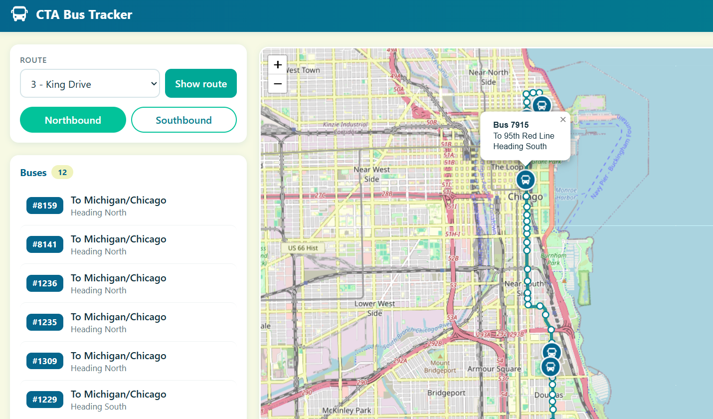

# CTA Bus Tracker

A live map of Chicago Transit buses. Pick a route and direction to see where every bus is right now, the route, and each stop in order.



## Features

- Live bus locations from the CTA Bus Tracker API
- Route shapes drawn from CTA pattern data, one direction at a time
- Ordered stop list; tap a bus or stop to zoom to it on the map

## Tech

- **Backend:** ASP.NET Core minimal API (C#, .NET 10). It proxies requests to the CTA so the API key never reaches the browser.
- **Frontend:** HTML, CSS
- **Map:** Leaflet

## Running locally

1. Get a free API key from the [CTA Developer Center](https://www.transitchicago.com/developers/bustracker/).
2. Store it with .NET user secrets so it stays out of the repo:
   ```bash
   cd BusTracker
   dotnet user-secrets init
   dotnet user-secrets set "CtaApiKey" "YOUR_KEY_HERE"
   ```
3. Run it:
   ```bash
   dotnet run
   ```
4. Open the URL shown in the terminal.

## Credits

Data from CTA Bus Tracker. Bus icon by [Hilmy Abiyyu A.](https://www.flaticon.com/authors/hilmy-abiyyu-a) on Flaticon. Map © OpenStreetMap contributors.